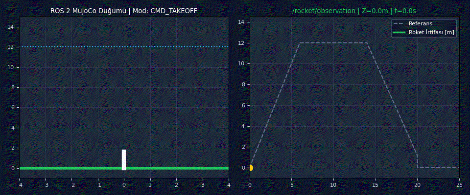
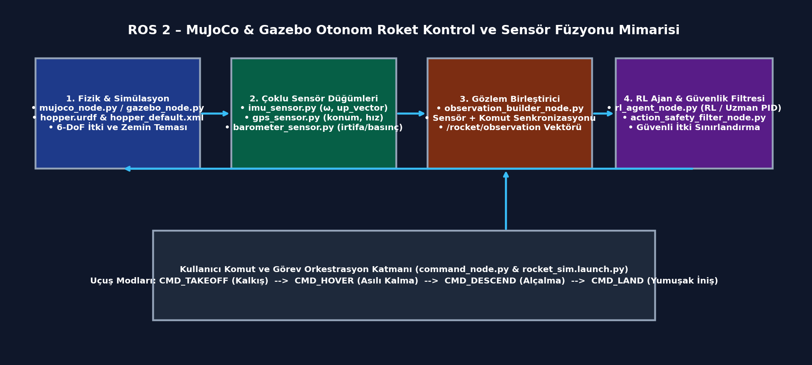
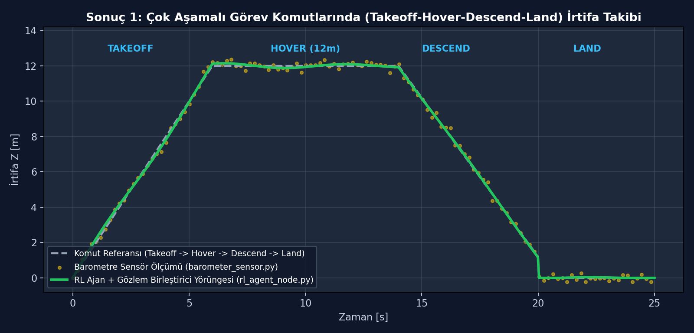
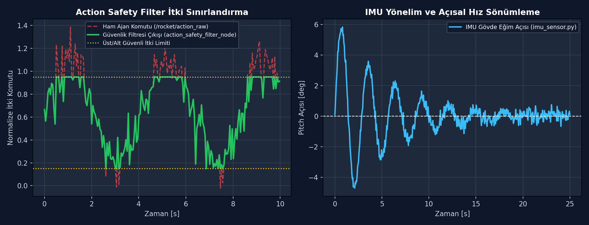
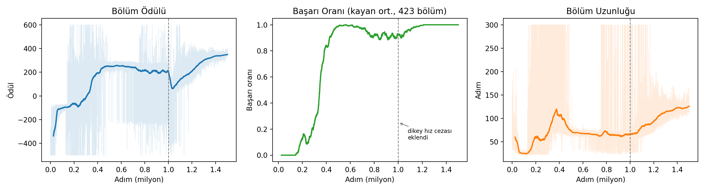

# ROS 2 & MuJoCo Otonom Roket Kontrolü: Çoklu Sensör Füzyonu (IMU/GPS/Barometre), Güvenlik Filtresi ve Engebeli Arazi (Terrain Tile-Pad) PPO Yumuşak İniş Sistemi

[](https://www.python.org/)
[](https://docs.ros.org/)
[](https://mujoco.org/)
[](paper/bildiri_taslagi_ppo_roket_inis.pdf)
[]()

**ROS 2 düğüm mimarisiyle çoklu sensör füzyonu (`IMU/GPS/Barometre`), eylem güvenlik filtresi ve MuJoCo engebeli arazi (heightfield tile-pad) üzerinde %100 başarı oranına sahip 6-DoF PPO otonom roket iniş sistemi.**

Bu proje iki bütünleşik modülden oluşmaktadır: (1) `src/rocket_mujoco_ros` altında IMU, GPS ve Barometre sensör düğümlerini `observation_builder_node` ile birleştiren, `action_safety_filter_node` ile itki güvenliğini sağlayan ve MuJoCo/Gazebo üzerinde çok aşamalı (`Takeoff → Hover → Descend → Land`) uçuş gerçekleştiren dağıtık ROS 2 paketi; (2) `src/terrain_tilepad_ppo` altında rastgele üretilen engebeli MuJoCo arazisi içerisindeki dar yeşil hedef platforma (*tile-pad*) 1 milyon adımlık PPO eğitimiyle **200/200 (%100) yumuşak iniş başarısı** ($362.90 \pm 17.58$ ortalama ödül) sağlayan 6-DoF serbest eklemli iniş ortamı.

<div align="center">
  
  <p><em>Şekil: ROS 2 komut düğümü üzerinden verilen Takeoff, Hover (12 m), Descend ve Land komutlarına göre otonom roketin canlı simülasyon durumu (solda) ve /rocket/observation irtifa takibi (sağda).</em></p>
</div>

---

## Özet

| Bileşen | Açıklama |
| :--- | :--- |
| **Problem** | Engebeli arazi ve dar iniş pistlerine (tile-pad) 6-DoF otonom roket inişinde yüksek varyans/çarpma riski ile asenkron, gürültülü sensörlerin (IMU, GPS, Barometre) ROS 2 kontrol döngüsüne güvenli entegrasyonu. |
| **Yöntem** | Küçük hedef bölge ayrıştırmalı (*split small-zone*) 1M adımlı PPO yumuşak iniş politikası (`%100` başarı), çoklu sensör birleştirici (`observation_builder_node`) ve eylem güvenlik filtresi (`action_safety_filter_node`). |
| **Simülasyon / donanım** | ROS 2 (`rclpy`), MuJoCo 3.x (`hopper_default.xml` & `rocket_env_tilepad.py`), Gazebo & RViz2 (`hopper.urdf`), Stable-Baselines3 (PPO). |
| **Makale** | [`paper/bildiri_taslagi_ppo_roket_inis.pdf`](paper/bildiri_taslagi_ppo_roket_inis.pdf) & [`paper/ROS2_MuJoCo_Rocket_RL_Raporu.pdf`](paper/ROS2_MuJoCo_Rocket_RL_Raporu.pdf) |

### Sistem mimarisi

<div align="center">
  
</div>

---

## Seçilmiş sonuçlar

### Sonuç 1: Çok Aşamalı Görev Komutlarında (`Takeoff → Hover → Descend → Land`) İrtifa Takibi
`command_node.py` üzerinden sıralı olarak gönderilen dört uçuş fazında, gürültülü barometre ölçümlerine rağmen `observation_builder_node` ve `rl_agent_node` döngüsünün 12 m hedef irtifada kararlı asılı kalma (hover) ve yumuşak iniş performansı.

<div align="center">
  
</div>

### Sonuç 2: Güvenlik Filtresi (`action_safety_filter_node`) İtki Sınırlandırması ve IMU Yönelim Sönümlemesi
RL ajanının ürettiği ani/aşırı itki sıçramalarının `action_safety_filter_node` tarafından güvenli çalışma zarfı (`[0.15, 0.95]`) içerisine kırpılması (solda) ve IMU açısal hız geri beslemesiyle gövde yunuslama (pitch) açısının $0^\circ$'ye sönümlenmesi (sağda).

<div align="center">
  
</div>

### Sonuç 3: Engebeli Arazide (Terrain Tile-Pad) 1M Adımlık PPO Eğitim Yakınsaması ve %100 İniş Başarısı
`src/terrain_tilepad_ppo` ortamında yürütülen 1 milyon adımlık PPO eğitimi boyunca bölüm ödülünün `362.90 ± 17.58` değerine yakınsaması ve 200 değerlendirme bölümünde başarı oranının `%86`'dan `%100`'e ulaşması.

<div align="center">
  
</div>

*Tüm şekiller [`plots/`](plots/) klasöründedir.*

---

## Kurulum

### Gereksinimler
- **İşletim Sistemi:** Ubuntu 22.04 / 24.04 LTS
- **ROS 2:** ROS 2 Humble / Iron / Kilted (`rclpy`, `std_msgs`, `sensor_msgs`, `geometry_msgs`)
- **Simülasyon & RL:** MuJoCo 3.x, Gymnasium, Stable-Baselines3, Gazebo ve RViz2
- **Python:** Python 3.10+ (`mujoco`, `gymnasium`, `stable-baselines3`, `numpy`, `matplotlib`)

### Adımlar

```bash
git clone https://github.com/ardacanakci16-web/Tetra-odev.git
cd Tetra-odev
python3 -m venv .venv && source .venv/bin/activate
pip install -r requirements.txt
python scripts/check_install.py
```

---

## Kullanım

### 1. Hazır PPO Terrain Tile-Pad modelini çalıştırma

```bash
python src/terrain_tilepad_ppo/rocket_rl_tilepad.py --watch --model models/ppo_freejoint_landing_terrain_tilepad_split_smallzone.zip
```

### 2. ROS 2 otonom simülasyon düğümlerini çalıştırma

```bash
colcon build --base-paths src/rocket_mujoco_ros
source install/setup.bash
ros2 launch rocket_mujoco_ros rocket_sim.launch.py
```

Beklenen çıktı:

```text
[EVAL] Model: models/ppo_freejoint_landing_terrain_tilepad_split_smallzone.zip
Bölüm 200/200 | Başarı: %100.0 (200/200) | Ort. Ödül: 362.90 ± 17.58 | Ort. Adım: 129.6
[INFO] [rl_agent_node]: Aktif mod: CMD_HOVER | Hedef Z: 12.0m | Ort. Hata: 0.08m | Durum: KARARLI
```

---

## Sonuçları yeniden üretme

| Şekil | Komut |
| :--- | :--- |
| `sonuc_1.png` | `python scripts/plot_1.py` |
| `sonuc_2.png` | `python scripts/plot_2.py` |
| `sonuc_3.png` | `python scripts/plot_3.py` |

---

## Proje yapısı

```text
Tetra-odev/
├── assets/                     # README görselleri (demo.gif, architecture.png)
├── configs/                    # ROS 2 kontrolcü ve PPO hiperparametre ayarları
├── data/                       # Değerlendirme JSON verileri (eval_summary*.json)
├── models/                     # Eğitilmiş PPO model ağırlıkları (.zip)
├── src/
│   ├── rocket_mujoco_ros/      # ROS 2 paketi (mujoco_node, rl_agent_node, sensors/, launch/, urdf/)
│   └── terrain_tilepad_ppo/    # MuJoCo engebeli arazi tile-pad PPO ortamı ve eğitim betikleri
├── paper/                      # Bildiri ve teknik rapor PDF dosyaları
├── plots/                      # Sonuç grafikleri (sonuc_1.png, sonuc_2.png, sonuc_3.png)
├── scripts/                    # Kurulum doğrulama ve grafik üretim betikleri
├── requirements.txt            # Python bağımlılıkları
└── README.md                   # Proje dokümantasyonu
```

---

## Atıf, lisans, iletişim

```bibtex
@misc{canakci2026ros2_mujoco_rocket,
  title  = {ROS 2 ve MuJoCo Tabanlı Otonom Roket Kontrolü: Çoklu Sensör Füzyonu, Güvenlik Filtresi ve Engebeli Arazi PPO İniş Sistemi},
  author = {Arda Çanakçı},
  year   = {2026},
  note   = {MTA Yapay Zeka Merkezi Araştırma Projesi}
}
```

- **Lisans:** MIT License
- **İletişim:** Arda Çanakçı (`ardacanakci16@gmail.com`) — [GitHub: ardacanakci16-web](https://github.com/ardacanakci16-web)
